# Project Guide — Crop Disease Early Warning from Multispectral Time Series

This guide explains the whole project from the ground up: what problem it
solves, where the data comes from, how every stage of the pipeline works,
how the live system fits together, how to run everything from a fresh
machine, what the results mean, and where each piece of code lives.

For a short overview, see [README.md](README.md).

---

## Contents

1. [What this project is](#1-what-this-project-is)
2. [The big picture](#2-the-big-picture)
3. [Data: from outbreak reports to labelled sequences](#3-data-from-outbreak-reports-to-labelled-sequences)
4. [The offline pipeline, phase by phase](#4-the-offline-pipeline-phase-by-phase)
5. [The models](#5-the-models)
6. [Training without overfitting](#6-training-without-overfitting)
7. [Quantum-inspired feature selection](#7-quantum-inspired-feature-selection)
8. [One inference path](#8-one-inference-path)
9. [The live system](#9-the-live-system)
10. [The REST API](#10-the-rest-api)
11. [Security](#11-security)
12. [Side experiments](#12-side-experiments)
13. [Running everything from a fresh machine](#13-running-everything-from-a-fresh-machine)
14. [Troubleshooting](#14-troubleshooting)
15. [Command and flag reference](#15-command-and-flag-reference)
16. [File-by-file reference](#16-file-by-file-reference)
17. [Tests](#17-tests)
18. [Results and what they mean](#18-results-and-what-they-mean)
19. [Design decisions](#19-design-decisions)
20. [Limitations](#20-limitations)
21. [Future work](#21-future-work)

---

## 1. What this project is

**The problem.** Plant diseases spread quickly. A farmer who knows a
field is stressed *before* symptoms are obvious can act earlier and more
cheaply. Diseased plants change how they reflect light: chlorophyll loss
shifts the **red edge** (700–780 nm), damaged leaf structure lowers
**near-infrared** reflectance, and water loss changes **short-wave infrared**.
Satellites and field sensors measure exactly these bands.

**What the system does.** Given a short time series of reflectance readings
in six bands, it predicts one of three states:

| Class | Name | Meaning |
|---|---|---|
| 0 | **Healthy** | No outbreak expected soon |
| 1 | **Early Stress** | The weeks just before an outbreak is reported |
| 2 | **Active Disease** | An outbreak has been reported |

| Band | Wavelength | What it tracks |
|---|---|---|
| `red_edge_705`, `red_edge_740`, `red_edge_783` | Red edge | Chlorophyll content; the edge shifts under stress |
| `nir_842` | Near-infrared | Leaf cell structure, canopy vigour |
| `swir_1610`, `swir_2190` | Short-wave infrared | Leaf water content |

**What is in the repository.**

- **An offline research pipeline** that builds a real dataset from public
  sources, then tunes, trains, compares and maps five model families, plus
  quantum-inspired feature selection.
- **A live system** that streams held-out field data over encrypted MQTT,
  predicts once per complete sequence, stores everything in InfluxDB and
  shows it on four Grafana dashboards with alerts. A REST API serves the same model.
- **Side experiments** on three more real datasets, which test the idea at
  other scales: UAV, lab hyperspectral and satellite crop types.

**The honest headline.** The models work, but most of their skill comes
from *when and where* an image was taken, not from the spectra. This
follows from how the only available labels are defined (§3.3). The project
measures that share explicitly instead of hiding it (§18).

---

## 2. The big picture

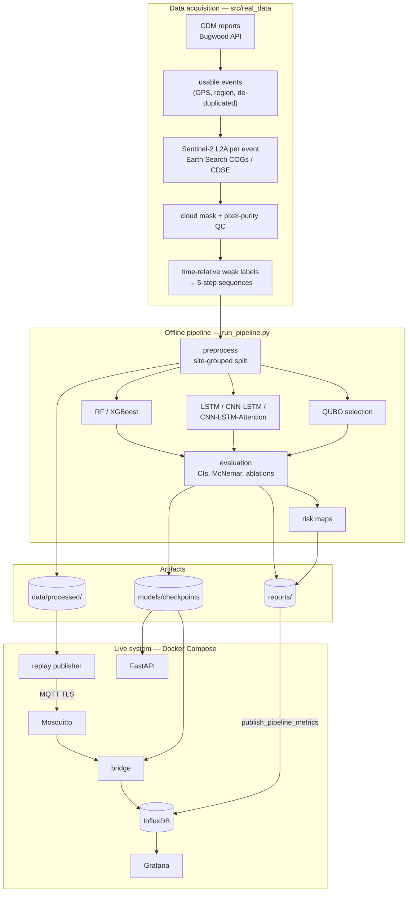

The two halves share **one inference code path** (§8). The model, its
scaler and its calibration travel together inside each checkpoint, so the
live system makes exactly the predictions the offline evaluation measured.

---

## 3. Data: from outbreak reports to labelled sequences

### 3.1 Sources

| Dataset | Source | Used for |
|---|---|---|
| **CDM reports** | ipmPIPE / Bugwood public API behind cdm.ipmpipe.org | When and where cucurbit downy mildew was reported |
| **Sentinel-2 L2A** | Element 84 Earth Search COGs (anonymous), or the CDSE Statistical API (`--backend cdse`, OAuth) | Reflectance in B05/B06/B07/B08/B11/B12 — exactly the six project bands |
| EthCT2020 | Mendeley Data ZIP | Positive control for the Sentinel-2 extraction (§12.2) |
| Vineyard | Zenodo 14936376 | UAV test (§12.1) |
| Septoria | INRAE doi:10.57745/WVP0FJ | Lab hyperspectral test (§12.3) |

### 3.2 Building the dataset


1. **`cdm`** downloads the reports, normalises them, and flags usable
   events: GPS present, inside the region, and repeat reports from one site
   merged (`--min-days-between 30`). The public API gives GPS for 87 usable
   events from 2021 on, and no host, incidence or severity
   (`--extra-csv` merges them in if you have an export).
2. **`s2-cdm`** reads, for every event, all Sentinel-2 acquisitions from
   120 days before to 45 days after the report (`--days-before`,
   `--days-after`). Each acquisition is reduced to a **3×3 block of 20 m
   pixels** around the field (B08 is block-averaged from 10 m). Results are
   cached per point, so the step can be resumed.
3. **`temporal`** applies QC, defines the labels and cuts the sequences.

**Quality control.** Pixels must be vegetation or bare soil in the scene
classification layer (SCL), with reflectance in (0, 1]. An acquisition passes only if:

- ≥ 67% of the block and its centre pixel are valid;
- ≥ 50% of the valid pixels are vegetation;
- the NIR coefficient of variation is ≤ 0.25 (a homogeneous field).

Failures are kept, with a `qc_reason`. Of 2,566 acquisitions for 86 events,
**761 pass**. The rejections are: 902 cloud or no data, 706 not vegetated,
104 too cloudy, and 89 heterogeneous (`reports/event_qc_summary.csv`).

### 3.3 Labels: time relative to the report

All CDM reports are positives: there are no reports of healthy fields. So
each site serves as its own control over time. A sequence of 5 QC-passing
acquisitions ending on an *anchor date* gets its label from where that
anchor falls relative to the report date:


| Anchor relative to report | Label |
|---|---|
| more than 21 days before | 0 Healthy |
| 21 to 0 days before | 1 Early Stress |
| 0 to 45 days after | 2 Active Disease |

The window sizes are set with `--early-window 21` and `--post-window 45`.
Sequences with gaps longer than 45 days are dropped (`--max-gap-days`). The result is **521
sequences of 5 acquisitions from 49 sites and 50 reports** (2023–2026):
219 Healthy, 85 Early Stress, 217 Active Disease.

> **Why this matters.** A label defined by the calendar is partly
> predictable from the calendar. Healthy sequences end on average around
> day 161 of the year, Active Disease around day 230. So day of year alone
> separates the classes well. §18 measures how much the spectra add on top.

### 3.4 Features

For each acquisition (`src/features/`):

| Group | Features | Notes |
|---|---|---|
| Bands (6) | the six reflectances | |
| Indices (6) | NDRE, NDVI (red-edge variant), MSI, SWIR ratio, REIP, CRI | Denominators floored, always finite; REIP by stable interpolation, clipped to 705–783 nm |
| Context (4) | day of year as sin and cos, latitude, longitude | Every real reading has a date and a place, so these are legitimate inputs |

That gives **16 features per step**. Two views are built from the same split:

- **Sequences** `(n, 5, 16)` for the deep models.
- **Aggregated features** `(n, 52)` for RF, XGBoost and QUBO: for each of the 12
  spectral features, the **mean, std, slope** (least-squares trend) and
  **delta** (mean of the last 3 steps minus the first 3), plus the 4 context
  values at the last step.

---

## 4. The offline pipeline, phase by phase

`python run_pipeline.py` runs six phases:

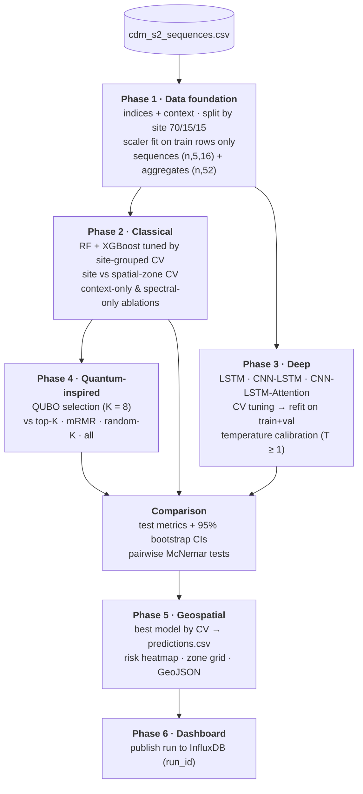

### Phase 1 — Data foundation (`src/data/preprocessor.py`)

1. Compute the indices and the context channels.
2. **Split by site**, label-stratified, about 70 / 15 / 15
   (`StratifiedGroupKFold`). Overlapping sequences from one field never
   appear in two splits.
3. Fit the `StandardScaler` on **training rows only**.
4. Build the sequences and aggregates. Samples shorter than 5 steps are
   dropped, never zero-padded.
5. Save the arrays, `scaler_params.json` and `sample_meta.csv` (id, label,
   lat, lon, site, split) to `data/processed/`.

### Phase 2 — Classical models

- Tune Random Forest and XGBoost by **site-grouped 5-fold CV on train+val**
  with the one-standard-error rule (§6). Then fit the chosen configuration on
  train+val with balanced class weights.
- Re-run CV with the chosen settings twice: **site** hold-out and
  **spatial-zone** hold-out (~0.1° GPS zones), and write
  `reports/classical_cv.csv`.
- **Ablations:** an RF on the context only (date + location) and an RF on
  the spectral features only, written to `reports/ablation_cv.csv`. They bracket the
  full models: the first is what the calendar and map give, the second what
  the spectra give alone.

### Phase 3 — Deep models

1. Tune each model over hidden size, dropout, weight decay and input-noise
   augmentation by site-grouped CV. Inside every fold, early stopping uses an
   **inner site hold-out**, never the fold being scored.
2. **Refit** the chosen configuration on all of train+val, for the median
   best epoch across the folds.
3. **Calibrate** with one temperature `T`, fitted on the out-of-fold logits
   and floored at T ≥ 1, so it can soften the refit model but never make it
   overconfident.
4. Save a **self-describing checkpoint**: weights, architecture, `seq_len`,
   scaler, temperature, label names, CV score and library versions, all
   plain types. It loads with `weights_only=True`.
5. Score the test sites through the `Predictor` and plot the confusion
   matrix, ROC curves and training curves.

### Phase 4 — Quantum-inspired feature selection

Covered in §7. The RF trained on the 8 QUBO features joins the model comparison.

### Comparison (`src/evaluation/evaluate.py`)

The test split is touched once, here. It reports accuracy, macro and weighted F1 and
per-class F1, each with a **95% bootstrap CI**, plus **pairwise McNemar tests**
(`model_comparison.csv`, `model_significance.csv`, `model_comparison.png`).

### Phase 5 — Geospatial (`src/geospatial/`)

The sequence model with the best **CV** macro-F1 predicts every sample
(`data/processed/predictions.csv`). Risk is
`Σ pᵢ·wᵢ, w = (0, 0.5, 1)`, binned into Low / Moderate / High / Critical.
Samples are aggregated on a metric grid (`--grid-size-m`). The outputs are
`disease_risk_map.html`, `zone_risk_map.html` and `zone_risk_scores.geojson`.

### Phase 6 — Dashboard

If InfluxDB is reachable, this phase publishes the run's reports as InfluxDB points,
tagged with a `run_id` that the Model Performance dashboard can select.
`--skip-mqtt` skips it; run `publish_pipeline_metrics` later instead.

---

## 5. The models

| Model | Input | Key idea |
|---|---|---|
| **Random Forest** | 52 aggregates | Shallow, heavily regularised trees; balanced class weights |
| **XGBoost** | 52 aggregates | Depth 1–3 boosting with strong L2 and min-child-weight |
| **LSTM** | 5 × 16 sequence | Stacked LSTM; the last hidden state feeds an MLP head |
| **CNN-LSTM** | 5 × 16 sequence | 1-D convolutions over time, then an LSTM; uses the last LSTM step |
| **CNN-LSTM-Attention** | 5 × 16 sequence | Same as CNN-LSTM, but **additive temporal attention** pools all steps. This is the served model |

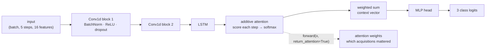

The plain CNN-LSTM is the same network without attention, which makes it
the attention ablation. Widths scale with `hidden_dim`. The tuned models are
small: the attention network has about 1.4k parameters.

---

## 6. Training without overfitting

Hundreds of overlapping sequences from a few dozen sites are easy to
memorise. Everything in `src/training/tuning.py` is built around that.

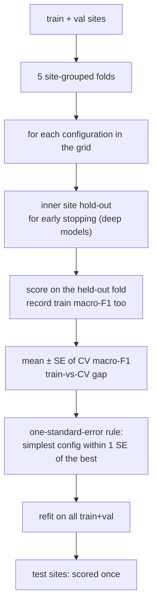

- **Grids lean towards regularisation.**
  - RF: depth 2–8, min leaf 5–30, features per split sqrt / 50% / all.
  - XGBoost: depth 1–3, learning rate 0.03–0.1, 50–150 trees, min child weight 5–20, L2 1–10.
  - Deep models: hidden size 8–32, dropout 0.3–0.5, weight decay 0.01–0.1, input noise 0.1–0.3.
- **One-standard-error rule.** Among configurations whose CV score is within
  one standard error of the best, take the simplest. That trades a
  statistically invisible bit of score for a model less likely to have fit
  noise.
- **The gap is reported.** Every configuration's training and CV macro-F1
  go to `reports/hyperparameter_tuning.csv`. A test fails if any chosen
  configuration has a gap above 0.35.
- **The deep-model training loop** uses class-weighted cross-entropy with
  label smoothing 0.05, AdamW, an LR scheduler, gradient clipping, optional
  Gaussian input noise, and checkpointing on validation macro-F1.

---

## 7. Quantum-inspired feature selection

The goal is to choose K = 8 of the 52 aggregated features that are
**relevant** to the label but **not redundant** with each other.

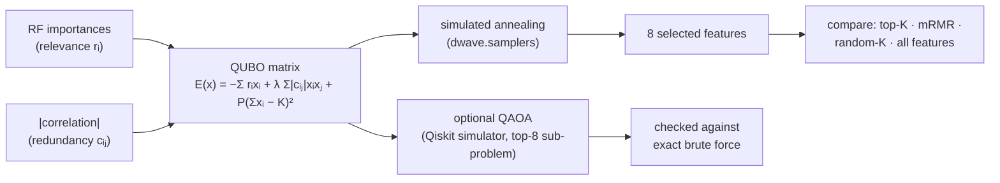

- `x` is a 0/1 vector over the features. Redundancy is penalised only above
  |c| > 0.7, and the cardinality penalty `P` makes "exactly K" the cheapest
  outcome.
- The solver is classical simulated annealing (1,000 reads). Without
  `dwave.samplers` it falls back to a NumPy solver.
- **Results:** QUBO matches all 52 features with 8. It ties with top-K and
  mRMR, and all three beat random subsets, which usually miss the date
  channels. QUBO always keeps day of year, plus red-edge and SWIR features.

---

## 8. One inference path

Every consumer, from the pipeline's test scoring to the API, the MQTT bridge and the history
backfill, turns raw readings into predictions through `src/inference/`.

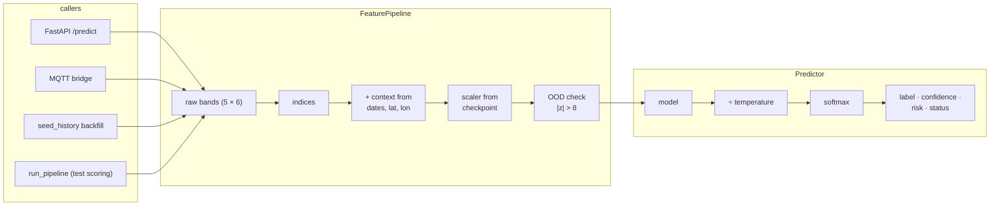

Because the scaler and temperature are saved inside the checkpoint,
train/serve skew is impossible by construction. A parity test asserts that
the API path and the offline path produce the same probabilities.

---

## 9. The live system

### 9.1 Components

| Container | Image | Role |
|---|---|---|
| `crop-mosquitto` | eclipse-mosquitto 2.0 | MQTT broker: TLS on 8883 only, username/password, ACL on `crop/#` |
| `crop-influxdb` | influxdb 2.7 | Time-series store, bucket `crop_data`, 30-day retention |
| `crop-grafana` | grafana-oss 10.4 | Four provisioned dashboards and three alert rules |
| `crop-simulator` | app image | **Replay publisher**: streams real held-out sequences |
| `crop-bridge` | app image | MQTT → validate → assemble → predict → InfluxDB |
| `crop-api` | app image | FastAPI on port 8000 |

The first three start with `docker compose up -d`. The app services need
`--profile app`. The app image contains a *copy* of `src/`, so rebuild it
(`--build`) after changing code. Checkpoints are mounted read-only from
`models/checkpoints/`.

### 9.2 Data flow

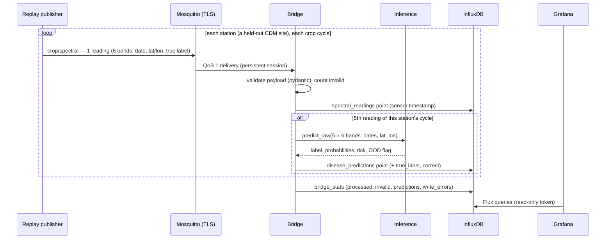

- **The replay publisher** (`src/data/mqtt_publisher.py`): each station is a
  real CDM site from the **test** split, at its real coordinates. Each "crop
  cycle" is one of that site's real labelled sequences, sent one reading at
  a time. The payload carries the sequence's true label, so the dashboard's
  live agreement is a genuine held-out score.
- **The bridge** (`src/dashboard/mqtt_subscriber.py`) uses a persistent MQTT
  session, so messages queue while it restarts. It predicts only on a
  **complete** 5-step cycle and writes points with the **sensor's** timestamp.
- **History backfill** (`src/dashboard/seed_history.py`) replays N hours
  through the *same* bridge function (`reading_to_records`), tagged
  `source=backfill`, so the dashboards fill instantly.
- **Offline results** (`src/dashboard/publish_pipeline_metrics.py`) turn
  `reports/*.csv` and `predictions.csv` into InfluxDB measurements.

### 9.3 InfluxDB schema

| Measurement | Tags | Key fields |
|---|---|---|
| `spectral_readings` | station_id, source, profile, lat, lon | 6 bands, 6 indices, latitude, longitude |
| `disease_predictions` | station_id, source, label, true_profile* | predicted_label, label_name, confidence, risk_score, prob_*, out_of_distribution, true_label*, correct* |
| `bridge_stats` | — | processed, invalid, predictions, write_errors |
| `pipeline_run`, `model_evaluation`, `model_significance`, `training_history`, `cross_validation`, `feature_selection`, `batch_risk` | run_id, model, … | metrics from `reports/` |

\* Only for replayed sequences, which carry their CDM label.

### 9.4 Dashboards and alerts

| Dashboard | Panels |
|---|---|
| **Field Overview** | Stations reporting, readings, predictions, mean risk, high-risk stations, live agreement; station risk map; latest prediction per station; risk over time; class timeline; prediction mix; class probabilities |
| **Spectral Analysis** | Band reflectance per station; NDVI, NDRE, MSI, REIP, SWIR ratio, red-edge chlorophyll index over time; NDVI heatmap; NDVI by true label; latest indices |
| **Model Performance** | Rolling live agreement; live confusion matrix; confidence histogram; OOD count; best model and score of the selected pipeline run; accuracy and F1 by model; McNemar table; CI table; training curves; site vs spatial CV; QUBO vs baselines; batch risk map; macro-F1 across runs |
| **System Health** | Seconds since last reading; readings per minute; invalid payloads; write errors; per-station rate; data by source; heartbeat; bridge throughput and errors; freshness |

All four share template variables `station` and `source`; Model
Performance also has `run_id`. The dashboards are **generated code**: edit
`src/dashboard/grafana/build_dashboards.py`, then regenerate the JSON with
`python -m src.dashboard.grafana.build_dashboards`.

The alert rules are: high risk at a station (latest risk above 0.7), no
readings for 5 minutes, and the bridge dropping payloads or failing writes. Attach a contact point in Grafana → Alerting.

---

## 10. The REST API

`src/api/main.py` (FastAPI). It takes **raw** reflectances, and the server does all
the feature engineering.

| Endpoint | Body / response |
|---|---|
| `POST /predict` | `readings`: 5 × 6 values in [0, 1]; `dates`: 5 ISO dates; `lat`, `lon` → label, probabilities, confidence, risk, status, OOD flag, model type, latency |
| `POST /predict/batch` | `sequences`, a `dates` list per sequence, `lat`/`lon` lists (capped size) |
| `GET /info` | model type, `seq_len`, `requires_context`, training metrics |
| `GET /health` | 200 with a model loaded, 503 without |
| `GET /metrics` | Prometheus |
| `GET /docs` | Interactive OpenAPI page |

`status` is `ok`, `low_confidence` (below `LOW_CONFIDENCE_THRESHOLD`) or
`out_of_distribution` (any standardised feature with |z| > 8, e.g. a field
far outside the training region). Settings come from the environment:
`API_KEYS`, `API_ALLOW_UNAUTHENTICATED`, `RATE_LIMIT_PER_MINUTE`,
`CORS_ORIGINS` and `MODEL_CHECKPOINT`.

---

## 11. Security

| Layer | Measure |
|---|---|
| Secrets | Only in `.env` (git-ignored); `.env.example` documents every variable |
| MQTT | TLS 1.2+ only, no plaintext listener; private CA from `scripts/gen_mqtt_certs.sh`; clients verify the CA and the hostname; username/password; ACL limits access to `crop/#` |
| InfluxDB | Bridge: **write-only** token. Grafana: **read-only** token. Admin token only for setup and deletes |
| API | `X-API-Key` (constant-time compare), per-client rate limit, body-size cap, batch cap, CORS off by default |
| Network | Every Docker port bound to `127.0.0.1` |
| Checkpoints | Loaded with `weights_only=True`, so no pickle code runs |
| Image | `certs/`, `.env` and data excluded from git and the Docker image |

---

## 12. Side experiments

Each side experiment asks whether the idea holds up at a different scale or
sensor. Their results are in `reports/`.

### 12.1 Vineyard UAV (MicaSense RedEdge-P)

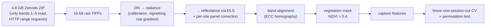

The archive's processed PNGs are 8-bit and contrast-stretched, so features
come from the raw TIFFs. Labels exist only per session (28 sessions, one
date). **Result:** RF balanced accuracy 0.64 at session level, permutation
p = 0.085. Diseased sessions show lower red-edge chlorophyll indices, but
nothing is significant, and variety and site are partly confounded with the labels.

### 12.2 EthCT2020 (Sentinel-2 crop types, Ethiopia)

This is a positive control for the Sentinel-2 extraction. Run on 120 fields
and 6 crops, Sep–Nov 2020: 46% of acquisitions pass QC, and crop type is
predicted with balanced accuracy **0.59–0.62 vs 0.17 chance** on spatially
held-out folds. The extraction carries real signal, but six similar crops
are hard to separate at 20 m.

### 12.3 Septoria tritici blotch (lab hyperspectral)

Durum wheat leaves were inoculated with *Zymoseptoria tritici* or with water
(controls). They were imaged by a **VNIR** (411–993 nm) and a **SWIR**
(964–2494 nm) HySpex camera on 18 dates (611 GB in total). The question is
whether the spectra separate inoculated from control leaves **before**
symptoms are visible.

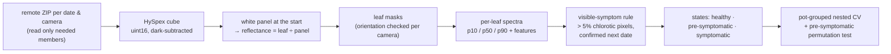

- **The annotations have no symptom dates.** There is one
  infection-confidence value per leaf, so inoculation alone cannot define
  "pre-symptomatic". A leaf counts as visibly abnormal when more than 5% of
  its pixels are chlorotic (red/green > 0.85), confirmed on the next date.
  Controls are scored the same way.
- **Detached leaves senesce:** control leaves also yellow from ~12–15 days
  after inoculation (dpi). The pre-symptomatic test therefore uses only
  windows in which **every** observation still looks normal, in both groups.
- **Cohort:** pots 37–48 (6 inoculated, 6 control), dpi −1, 4, 7, 10, 12,
  13, 14, 15. SWIR has 96 of 96 images; VNIR has 92 of 96. Three VNIR images
  are excluded because the masks no longer fit the drying leaves, and one
  is missing from the archives.
- **Results:**
  - VNIR + SWIR: best 3-state model macro-F1 **0.524**; pre-symptomatic
    inoculated vs control **AUC 0.558, p = 0.25**.
  - SWIR only: AUC 0.371, p = 0.68.
  - Adding VNIR moves the result in the expected direction, but it is not
    significant with 12 pots.

---

## 13. Running everything from a fresh machine

### 13.1 What you need

| Requirement | Version / note |
|---|---|
| Python | 3.12 or newer (tested on 3.14) |
| Git | any |
| Docker Desktop | with Compose v2 (`docker compose`) — for the live system only |
| bash + openssl | for the certificates; on Windows, Git Bash includes both |
| Internet | to build the dataset (no account needed) |
| Disk | a few GB for the main data; side experiments need much more (Septoria reads ~50 GB) |

### 13.2 The whole run at a glance

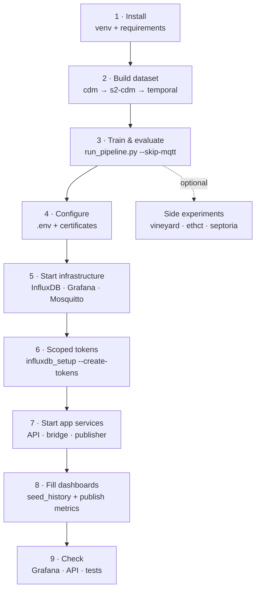

### Step 1 — Install

```bash
git clone <your-repo-url> Crop
cd Crop
python -m venv venv
venv\Scripts\activate            # Windows   (Linux/macOS: source venv/bin/activate)
pip install -r requirements.txt
```

One file installs everything: the pipeline, real-data tools, API, streaming,
QAOA, tests and lint. Run every later Python command inside the activated `venv`.

### Step 2 — Build the dataset (~1 hour)

```bash
python -m src.real_data cdm
python -m src.real_data s2-cdm
python -m src.real_data temporal
```

**Check:** `data/real/cdm_s2/cdm_s2_sequences.csv` exists, and the log reports
521 sequences from 49 sites. `s2-cdm` is resumable: if it stops, run it again.

### Step 3 — Train and evaluate (15–45 minutes)

```bash
python run_pipeline.py --skip-mqtt
```

**Check:**

- `models/checkpoints/cnn_lstm_attention_best.pt` exists.
- `reports/model_comparison.csv` lists 8 models.
- `reports/hyperparameter_tuning.csv` shows the train-vs-CV gaps.
- `reports/disease_risk_map.html` opens in a browser.

### Step 4 — Configure secrets and certificates

```bash
cp .env.example .env             # PowerShell: Copy-Item .env.example .env
```

Edit `.env` and replace **every** `change-me` value. Use long random strings for the
passwords, `INFLUX_TOKEN` and `API_KEYS`. Leave `INFLUX_WRITE_TOKEN` and
`INFLUX_READ_TOKEN` empty for now.

```bash
bash scripts/gen_mqtt_certs.sh   # creates certs/mqtt/ (CA + broker cert)
```

> Choose the InfluxDB and Grafana credentials **before** the first start.
> Both services save them in their data volumes on first start and ignore
> later changes to `.env` (see §14).

### Step 5 — Start the infrastructure

```bash
docker compose up -d
docker compose ps                # wait until influxdb shows "healthy"
```

### Step 6 — Create the scoped InfluxDB tokens

```bash
python -m src.dashboard.influxdb_setup --create-tokens
```

Copy the printed `INFLUX_WRITE_TOKEN` and `INFLUX_READ_TOKEN` into `.env`,
then apply them:

```bash
docker compose up -d             # recreates Grafana with the read-only token
```

### Step 7 — Start the app services

```bash
docker compose --profile app up -d --build
```

**Check:**

- `docker compose ps` shows `crop-api` as healthy, and `crop-bridge` and `crop-simulator` as up.
- `docker logs crop-bridge` shows lines like `S01 cycle 1 -> Active Disease (p=0.57, risk=0.73)`.

### Step 8 — Fill the dashboards

```bash
python -m src.dashboard.seed_history --hours 12
python -m src.dashboard.publish_pipeline_metrics
```

### Step 9 — Check everything

- **Grafana:** http://localhost:3000. Log in with `GRAFANA_ADMIN_USER` /
  `GRAFANA_ADMIN_PASSWORD`, then open the **Crop Disease** folder. All four
  dashboards should show data.
- **API:** http://localhost:8000/docs. Try `/health`, then `/predict` with
  your API key.
- **Tests:**

  ```bash
  pytest -m "not slow"
  pytest -m slow
  ruff check .
  ```

### Optional — side experiments

Their results are already in `reports/`. Rerun only to reproduce them, or
after changing their code.

```bash
# Vineyard UAV (~2.7 GB from Zenodo, resumable)
python -m src.real_data vineyard-fetch
python -m src.real_data vineyard

# EthCT2020 (download the dataset ZIP from Mendeley Data first)
python -m src.real_data ethct --zip-path "Ethiopian Crop Type 2020 (EthCT2020) dataset.zip" --n-fields 120

# Septoria (slow, unstable server: rerun the same command to resume)
python -m src.real_data septoria-fetch --sensors SWIR VNIR
#   with VNIR ZIPs downloaded by hand into data/real/septoria/archives/VNIR/:
#   python -m src.real_data septoria-fetch --sensors VNIR --local-only
python -m src.real_data septoria --sensors VNIR SWIR
python -m src.real_data septoria --sensors SWIR
```

### Daily use

| Task | Command |
|---|---|
| Start the whole stack | `docker compose --profile app up -d` |
| Stop it, keeping data | `docker compose --profile app down` |
| After changing code in `src/` | `docker compose --profile app up -d --build` |
| Retrain | `python run_pipeline.py --skip-mqtt`, then `python -m src.dashboard.publish_pipeline_metrics`, then restart the bridge and API |
| Refresh dashboard history | `python -m src.dashboard.seed_history --clear`, then `--hours 12` |
| Regenerate the dashboards after editing them | `python -m src.dashboard.grafana.build_dashboards`, then `docker compose restart grafana` |

---

## 14. Troubleshooting

| Symptom | Cause | Fix |
|---|---|---|
| `influxdb_setup` → **401 Unauthorized** | InfluxDB applies `DOCKER_INFLUXDB_INIT_*` (including the admin token) only when its volume is empty, so it kept the token from its first start | Put the existing token in `.env` (`docker exec crop-influxdb influx auth list`), **or** reset it: `docker compose down`, then `docker volume rm crop_influxdb_data crop_influxdb_config`, then `docker compose up -d` (stored history is lost; Step 8 recreates it) |
| Grafana **"invalid username or password"** | Same: Grafana kept the admin password from its first start | `docker exec crop-grafana grafana cli admin reset-admin-password <password from .env>` |
| `crop-bridge` **restarting**, `crop-api` **unhealthy**, log says `Unknown model type` | The app image is older than the code | `docker compose --profile app up -d --build` |
| Dashboards show **No data** | Bridge down, wrong tokens, or nothing published yet | Check `docker logs crop-bridge` and the tokens in `.env`, then rerun Step 8 |
| `publish_pipeline_metrics` fails on `sample_id` | Old code converted string ids to int | Update to the current code |
| Mosquitto exits: **missing TLS certificates** | `certs/mqtt/` not generated | `bash scripts/gen_mqtt_certs.sh` |
| MQTT TLS hostname errors from another machine | The certificate covers only `mosquitto`, `localhost` and `127.0.0.1` | `MQTT_CERT_HOSTS="host,10.0.0.5" bash scripts/gen_mqtt_certs.sh --force` |
| `s2-cdm` or `septoria-fetch` stops with network errors | Remote servers throttle connections or drop them | Rerun the same command; finished work is cached |
| Tests fail with `ModuleNotFoundError` (paho, influxdb_client, cv2) | Running outside the venv | Activate the `venv`, or `pip install -r requirements.txt` |

---

## 15. Command and flag reference

### `run_pipeline.py`

| Flag | Default | Effect |
|---|---|---|
| `--seq-len` | inferred | Timesteps per sequence; must match the dataset |
| `--epochs` / `--patience` | 80 / 12 | Training length and early stopping |
| `--no-tune` | off | Skip CV tuning; use the hyperparameters below |
| `--cv-folds` | 5 | Site-grouped folds for tuning |
| `--hidden-dim`, `--dropout`, `--weight-decay`, `--noise-std` | 32, 0.5, 1e-2, 0.1 | Deep-model settings when not tuning |
| `--batch-size`, `--lr` | 32, 1e-3 | Optimiser |
| `--models` | `lstm cnn_lstm cnn_lstm_attention` | Which sequence models to train |
| `--no-context` | off | Spectral features only (no date or location) |
| `--max-features` | 8 | K for QUBO |
| `--use-qaoa` | off | Also run QAOA on the top-8 sub-problem |
| `--grid-size-m` | 50000 | Risk-zone cell size in metres |
| `--skip-quantum`, `--skip-geo`, `--skip-mqtt` | off | Skip Phase 4, 5 or 6 |
| `--seed` | 42 | Seeds everything |

### `python -m src.real_data <command>`

| Command | Does | Main options |
|---|---|---|
| `cdm` | CDM reports → `data/real/cdm/` | `--years`, `--extra-csv`, `--min-days-between` |
| `s2-cdm` | Sentinel-2 around each event | `--backend earthsearch\|cdse`, `--days-before`, `--days-after`, `--limit`, QC thresholds |
| `temporal` | Labelled sequences | `--seq-len`, `--early-window`, `--post-window`, `--max-gap-days`, `--no-purity` |
| `vineyard-fetch` / `vineyard` | UAV download / experiment | `--sessions`, `--bands`, `--task`, `--panel-albedo`, `--permutations` |
| `ethct` | Crop-type control | `--zip-path`, `--n-fields`, `--start`, `--end` |
| `schema` | Sensor-independent feature table | |
| `septoria-fetch` / `septoria` | Lab hyperspectral extraction / experiment | `--sensors`, `--local-only`, `--workers`, `--seq-len`, `--outer-folds`, `--permutations` |

### Live-system tools

| Command | Options |
|---|---|
| `python -m src.dashboard.influxdb_setup` | `--create-tokens` |
| `python -m src.dashboard.seed_history` | `--hours`, `--interval-s`, `--stations`, `--clear` |
| `python -m src.dashboard.publish_pipeline_metrics` | |
| `python -m src.dashboard.mqtt_subscriber` | `--model-path` |
| `python -m src.data.mqtt_publisher` | `--split test\|val\|train\|all`, `--interval`, `--stations`, `--max-messages` |
| `python -m src.dashboard.grafana.build_dashboards` | `--check` |
| `uvicorn src.api.main:app --port 8000` | |

---

## 16. File-by-file reference

### 16.1 Root

| File | Purpose |
|---|---|
| `run_pipeline.py` | End-to-end offline runner (§4) |
| `README.md` / `PROJECT_GUIDE.md` | Overview / this guide |
| `docker-compose.yml` | InfluxDB, Grafana, Mosquitto; API, bridge and publisher under `--profile app` |
| `Dockerfile` | App image (installs `requirements.txt`, copies `src/` and `config/`) |
| `.env.example` | Template for every secret and setting |
| `.gitignore` / `.dockerignore` | Keep data, checkpoints, reports, `.env` and `certs/` out of git and the image |
| `.gitattributes` | LF endings for shell scripts and broker config |
| `pyproject.toml` | Metadata, ruff and pytest configuration (marker `slow`) |
| `requirements.txt` | Every dependency in one file |
| `.pre-commit-config.yaml`, `.github/workflows/ci.yml` | Lint hooks and CI |

### 16.2 `config/` and `scripts/`

| File | Purpose |
|---|---|
| `config/mqtt.ini` | Broker host, port 8883, topic, QoS, client id, CA path (credentials from env) |
| `config/influxdb.ini` | URL, org, bucket (tokens from env) |
| `config/mosquitto.conf` | TLS-only listener, no anonymous access, password and ACL files |
| `config/mosquitto.acl` | The service user may only use `crop/#` |
| `scripts/gen_mqtt_certs.sh` | Local CA + broker certificate in `certs/mqtt/`; `MQTT_CERT_HOSTS` and `--force` |

### 16.3 `src/`

| Path | Purpose |
|---|---|
| `constants.py` | `BANDS`, `INDICES`, `LABEL_NAMES`, `RISK_WEIGHTS`, risk bins, `expected_risk`, `zone_key` |
| `config.py` | INI + env loading (`load_mqtt_config`, `load_influx_config`), TLS context, MQTT client factory |
| `real_data/common.py` | Output folders, HTTP session with retries, seekable HTTP range file, parallel ZIP member reader |
| `real_data/cdm.py` | CDM reports from the Bugwood API; normalisation, flags, optional export merge |
| `real_data/sentinel2.py` | Point time series of the six bands; Earth Search and CDSE backends; SCL masking and purity QC; per-point cache |
| `real_data/temporal.py` | CDM + Sentinel-2 → labelled sequences |
| `real_data/feature_schema.py` | Sensor-independent band and index schema |
| `real_data/vineyard.py` | UAV download, radiometric calibration, alignment, features, experiment |
| `real_data/ethct.py` | EthCT2020 sampling, purity statistics, crop separability |
| `real_data/septoria.py` | Remote ZIP reading, cube calibration, leaf masks, features, symptom rule, cohort assembly |
| `real_data/septoria_experiment.py` | Pot-grouped nested CV, QUBO inside folds, pre-symptomatic permutation test |
| `real_data/__main__.py` | The `python -m src.real_data` CLI |
| `data/preprocessor.py` | Site-grouped split, train-only scaler, sequences, aggregates → `data/processed/` |
| `data/mqtt_publisher.py` | Replay publisher of held-out real sequences |
| `features/spectral_indices.py` | NDRE, NDVI, MSI, SWIR ratio, REIP, CRI (finite-checked) |
| `features/context.py` | Day-of-year sin/cos, lat, lon channels |
| `models/lstm_model.py` | `SpectralLSTM` |
| `models/cnn_lstm_model.py` | `CNNLSTMModel` with optional temporal attention |
| `models/factory.py` | `MODEL_TYPES`, `build_model`, `build_model_from_config`, `count_parameters` |
| `models/classical_models.py` | RF/XGBoost factories, balanced weights, CV, save and load |
| `training/train.py` | Training loop, class weights, temperature fitting, checkpoints, `train_from_arrays` |
| `training/tuning.py` | Grouped folds, grids, one-SE rule, classical and sequence-model tuning |
| `inference/pipeline.py` | `FeaturePipeline`: raw → model input, OOD check |
| `inference/predictor.py` | `Predictor.predict_raw` and safe checkpoint loading |
| `evaluation/evaluate.py` | Metrics, bootstrap CIs, McNemar, plots, `compare_models` |
| `quantum/qubo_feature_selector.py` | QUBO matrix, energy, interpretation |
| `quantum/annealing_optimizer.py` | Simulated annealing, QAOA, NumPy fallback, brute force |
| `quantum/integration.py` | Phase 4 flow, baselines, `select_qubo` for use inside folds |
| `geospatial/risk_mapper.py` | Risk GeoDataFrame, metric zone grid, GeoJSON |
| `geospatial/heatmap.py` | Folium heatmap and zone map |
| `api/main.py` | FastAPI app, auth, limits, endpoints |
| `dashboard/mqtt_subscriber.py` | The bridge |
| `dashboard/influxdb_setup.py` | Health check, bucket, scoped tokens |
| `dashboard/seed_history.py` | History backfill through the bridge path |
| `dashboard/publish_pipeline_metrics.py` | `reports/` → InfluxDB |
| `dashboard/grafana/build_dashboards.py` | Dashboards as code (generates `dashboards/*.json`) |
| `dashboard/grafana/datasources/`, `alerting/` | Provisioned datasource and alert rules |

### 16.4 Generated folders (not in git)

| Folder | Contents |
|---|---|
| `data/real/` | CDM tables, Sentinel-2 cache, sequences, Vineyard, EthCT2020, Septoria spectra and previews |
| `data/processed/` | Split arrays, `scaler_params.json`, `sample_meta.csv`, `predictions.csv` |
| `models/checkpoints/` | `lstm_best.pt`, `cnn_lstm_best.pt`, `cnn_lstm_attention_best.pt`, `rf_model.joblib`, `xgb_model.joblib`, `rf_qubo_model.joblib` |
| `reports/` | Metrics, CV, tuning, McNemar, QUBO, plots, maps; `vineyard/`, `ethct/`, `septoria/` |
| `certs/mqtt/` | CA and broker certificate and key (keep `ca.key` private) |

---

## 17. Tests

221 tests run on `tests/fixtures/`, a committed snapshot of the real
CDM + Sentinel-2 sequences and the Septoria annotations, so no network is needed.

| File | Covers |
|---|---|
| `test_features.py` | Indices on real readings; finite values; REIP range; array/DataFrame parity |
| `test_preprocessing.py` | No site in two splits; train-only scaler; aggregates; short samples dropped |
| `test_models.py` | Shapes, attention on/off, width scaling, factory round-trip |
| `test_tuning.py` | Grouped folds, one-SE rule, classical and sequence searches, gap reporting |
| `test_inference.py` | Checkpoint round-trip, calibration, OOD flag, **train/serve parity** |
| `test_api.py` | Auth, validation, limits, batch, health, info, metrics |
| `test_streaming.py` | Replay publisher, payload validation, sequence assembly, TLS |
| `test_quantum.py` | QUBO construction, cardinality penalty, agreement with brute force |
| `test_geospatial.py` | GeoDataFrames, grid, maps, GeoJSON |
| `test_dashboards.py` | JSON up to date, layout, **every queried field is written**, bridge points, backfill, pipeline metrics |
| `test_performance.py` | After a run: models beat majority class; gaps below 0.35 |
| `test_integration.py` | End-to-end pipeline, tuned and `--no-tune` (`-m slow`) |
| `test_real_data.py` | CDM, QC rules, CDSE parsing, labelling, splits, schema, MicaSense radiometry, Vineyard |
| `test_septoria.py` | Annotations, cube calibration, mask orientation, features, symptom rule, windows, partial archives |

```bash
pytest -m "not slow"      # fast suite
pytest -m slow            # end-to-end
pytest --cov              # coverage (CI requires ≥ 70%)
ruff check .
```

---

## 18. Results and what they mean

### 18.1 Main dataset (`run_pipeline.py`, seed 42)

| Model | CV macro-F1 | Train − CV gap | Test macro-F1 | Test accuracy [95% CI] |
|---|---|---|---|---|
| Random Forest | **0.609 ± 0.061** | 0.07 | 0.657 | 0.735 [0.639, 0.831] |
| RF, 8 QUBO features | 0.618 ± 0.126 | — | 0.659 | 0.735 [0.639, 0.831] |
| XGBoost | **0.606 ± 0.045** | 0.07 | 0.610 | 0.687 [0.578, 0.783] |
| LSTM | 0.542 ± 0.025 | 0.12 | 0.575 | 0.663 [0.554, 0.771] |
| CNN-LSTM | 0.533 ± 0.046 | 0.11 | 0.515 | 0.651 [0.554, 0.747] |
| CNN-LSTM-Attention | 0.553 ± 0.034 | 0.10 | 0.595 | 0.723 [0.626, 0.807] |
| *Context-only RF* | 0.622 ± 0.100 | — | 0.522 | 0.651 [0.542, 0.759] |
| *Spectral-only RF* | 0.384 ± 0.079 | — | 0.402 | 0.506 [0.398, 0.614] |

Chance macro-F1 is about 0.33.

### 18.2 What the numbers say

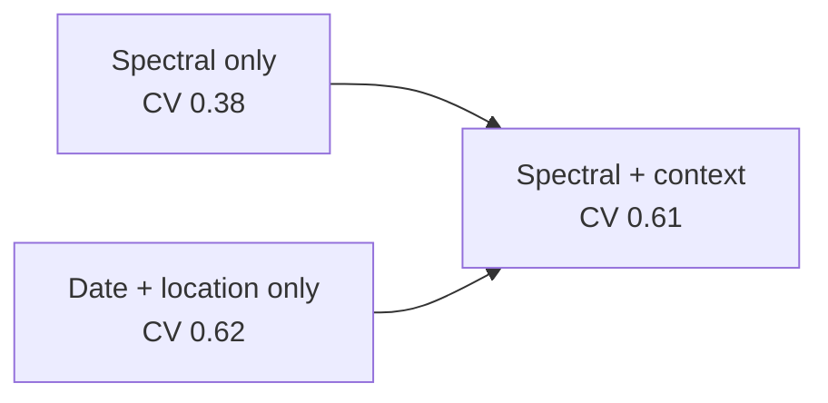

- **Date and location carry most of the signal.** This follows from
  time-relative labels (§3.3). Adding the spectra to the context does not
  improve CV.
- **The gain is not memorised geography.** Holding out ~0.1° spatial zones
  instead of sites gives the same scores (RF 0.612, XGBoost 0.610).
- **Every full model significantly beats spectral-only** (McNemar
  p ≤ 0.036). The differences among the full models are not significant.
- **Deep models do not beat the trees** on 521 sequences.
- **QUBO** reduces 52 features to 8 at no loss, but it is not better than top-K or mRMR.
- **No overfitting:** the chosen configurations have gaps of 0.07–0.12.
- **Side experiments (§12):** the Sentinel-2 extraction carries signal
  (EthCT2020). The UAV and lab tests show plausible but non-significant effects.

---

## 19. Design decisions

- **One inference path.** The scaler and temperature live inside the
  checkpoint, and every consumer uses `src/inference/`, so there is no train/serve skew.
- **Split by site, not by sample.** Overlapping sequences from one field
  look alike, so a site never appears in two splits or in two CV folds.
- **The one-standard-error rule and reported gaps** make overfitting
  visible and push towards simpler models.
- **Context as an input, with its share measured.** The context-only and
  spectral-only ablations are part of every comparison.
- **Macro-F1 for selection.** Early Stress is the smallest and most useful
  class; accuracy would hide failures on it.
- **Calibrated, probability-weighted risk.** Uncertain predictions give
  intermediate risk, not a hard class.
- **One prediction per complete cycle.** The bridge never predicts on a
  partial or padded sequence.
- **Honest "quantum".** QUBO is compared with simple baselines, and QAOA is
  checked against the exact optimum.
- **Dashboards as code.** Generated JSON, plus a test that every queried field is written.
- **Fail loudly on data problems.** Septoria masks that don't fit, empty
  archive indexes and partial ZIPs raise errors instead of producing
  silent features.

---

## 20. Limitations

- **Weak labels.** Report dates, not observed disease. A field labelled
  Healthy may already be infected, and reports can lag outbreaks.
- **Small data.** 521 sequences from 49 sites; only 85 Early Stress sequences.
- **One disease, one region:** cucurbit downy mildew in the eastern US.
- **20 m pixels:** cucurbit fields are often only a few pixels wide.
  70% of acquisitions fail QC.
- **The spectra add no measurable skill over date and location.** The
  project does not show that Sentinel-2 detects CDM on its own.
- **Septoria:** 12 pots; colour cannot tell Septoria lesions from senescence or tip necrosis.
- **Vineyard:** 8 healthy sessions; variety and site confounded with labels.
- **The live system replays** held-out data; it has no live sensor feed.

---

## 21. Future work

1. **Better labels:** plot-level ground truth with healthy controls; host,
   incidence and severity from ipmPIPE; a small instrumented field trial.
2. **Higher resolution:** PlanetScope or UAV imagery for small fields.
3. **Disease pressure features:** neighbouring reports (distance- and
   time-weighted) and weather (humidity, leaf wetness).
4. **Irregular time steps:** feed acquisition gaps to the model (masking,
   Time2Vec, or transformers with timestamps).
5. **Lead-time evaluation:** how many days before a report the model can flag stress.
6. **Uncertainty:** conformal prediction or deep ensembles; better OOD
   detection (Mahalanobis or energy scores).
7. **Explainability:** SHAP for the trees; attention and integrated
   gradients for the networks, shown per prediction.
8. **Septoria:** a larger cohort (more pots, both sides, later dates) and
   lesion-level symptom scoring.
9. **Operations:** mutual TLS per device, a model registry with hot reload,
   drift monitoring, alert routing, InfluxDB downsampling tasks.
10. **Engineering:** type checking, a CI job that starts the Docker stack and
    checks every dashboard query returns data, multi-architecture images.
