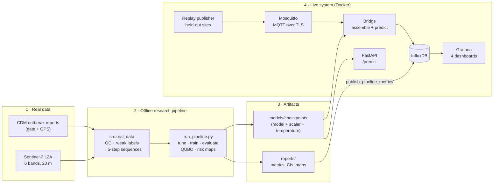
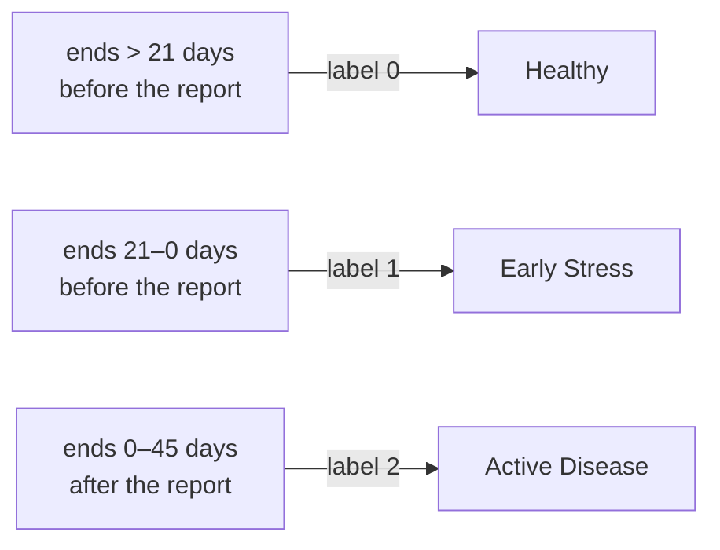
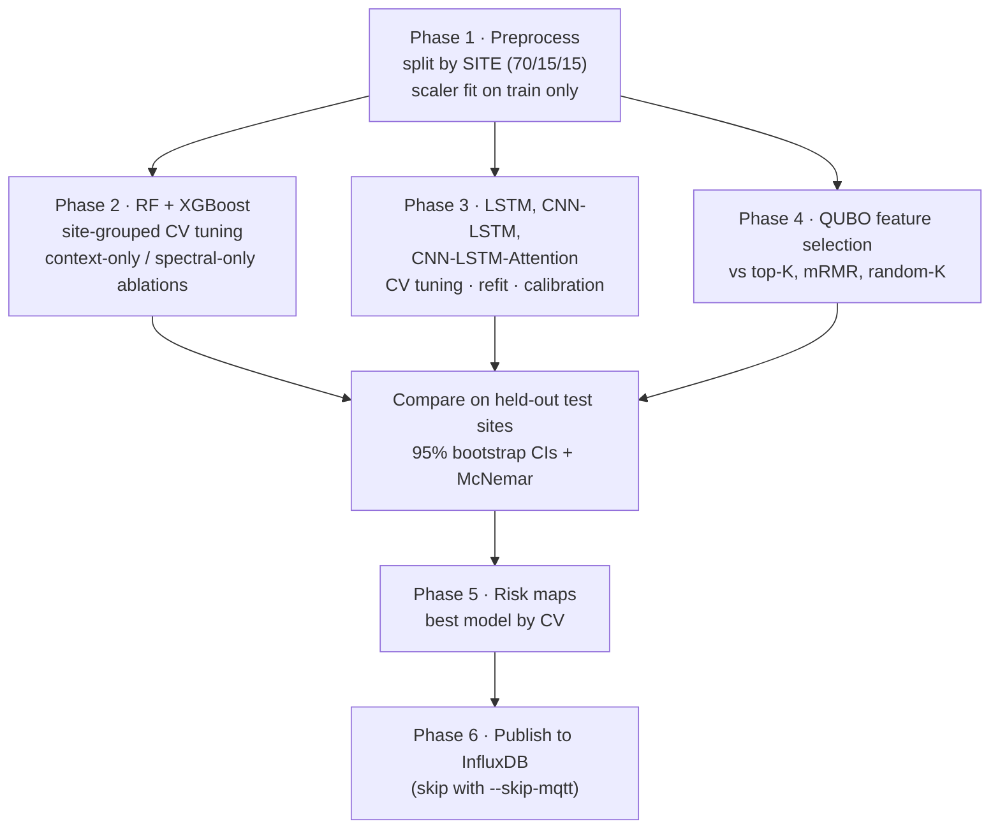
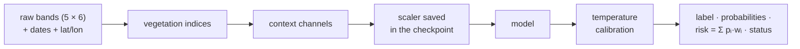

# Crop Disease Early Warning from Multispectral Time Series

Classifies crop health as **Healthy**, **Early Stress** or **Active Disease**
from time series of red-edge, near-infrared and short-wave-infrared
reflectance. It is trained on real data: cucurbit downy mildew (CDM) outbreak
reports matched to Sentinel-2 satellite images. Predictions are served through a REST API and a live
MQTT → InfluxDB → Grafana dashboard.

The project compares Random Forest, XGBoost, LSTM, CNN-LSTM and a
**CNN-LSTM with temporal attention**, adds **quantum-inspired QUBO feature
selection**, builds geo-spatial **risk maps**, and tests the approach on three
more real datasets (vineyard UAV imagery, Ethiopian crop types, and a lab
hyperspectral wheat-disease trial).

For a full explanation of every part, with diagrams, read
**[PROJECT_GUIDE.md](PROJECT_GUIDE.md)**.

> **Limitations — read first**
> - **The labels are weak and follow the calendar.** CDM reports only say
>   *when and where* an outbreak was reported, so the classes are defined by
>   time relative to that date. Date and location alone reach CV macro-F1
>   0.62; spectra alone reach 0.38; both together reach 0.61. **The models do not
>   show that Sentinel-2 detects downy mildew on its own.**
> - **The dataset is small:** 521 sequences from 49 sites. Use the
>   site-grouped CV scores; the 83-sequence test split has wide intervals.
> - **"Quantum" means quantum-inspired:** the QUBO is solved by simulated
>   annealing on a CPU. Optional QAOA runs on a simulator. No quantum hardware is used.

---

## Contents

- [Features](#features)
- [How it works](#how-it-works)
- [Getting started](#getting-started)
- [Using the API](#using-the-api)
- [Dashboards](#dashboards)
- [Data](#data)
- [Results](#results)
- [Testing](#testing)
- [Project structure](#project-structure)
- [Troubleshooting](#troubleshooting)

---

## Features

| Area | What you get |
|---|---|
| **Real data** | CDM outbreak reports + Sentinel-2 L2A time series (anonymous Earth Search COGs or CDSE), cloud masking and pixel-purity QC |
| **Models** | Random Forest, XGBoost, LSTM, CNN-LSTM, CNN-LSTM-Attention (attention weights per prediction) |
| **No overfitting by design** | Site-grouped split and CV, one-standard-error model selection, early stopping on an inner hold-out, train-vs-CV gap reported for every configuration |
| **Honest evaluation** | 95% bootstrap CIs, McNemar tests, context-only and spectral-only ablations, spatial-zone CV |
| **Quantum-inspired** | QUBO feature selection (simulated annealing, optional QAOA) compared with top-K, mRMR, random-K and all features |
| **Calibrated output** | Temperature-scaled probabilities, a probability-weighted risk score, low-confidence and out-of-distribution flags |
| **Maps** | Folium risk heatmaps and a metric zone grid exported as GeoJSON |
| **Live system** | TLS-encrypted MQTT replay of held-out sites → bridge → InfluxDB → 4 Grafana dashboards with 3 alert rules |
| **API** | FastAPI with API keys, rate limiting, body/batch caps, Prometheus metrics |
| **Side experiments** | Vineyard UAV (MicaSense), EthCT2020 crop types, Septoria lab hyperspectral (VNIR + SWIR) |
| **Quality** | 221 tests on real data fixtures, ruff, CI, dashboards defined as code |

---

## How it works

### System overview



### From outbreak reports to labelled sequences

Each CDM report gives a date and a location. For every report, the
Sentinel-2 images around that location are fetched and cloud-checked. A
sequence of 5 clean images is then labelled by **when it ends relative to
the report**:



Every acquisition gives **16 features**: 6 bands, 6 vegetation indices (NDRE,
NDVI, MSI, SWIR ratio, REIP, CRI), and 4 context channels (day of year as
sin/cos, latitude, longitude). The deep models read the 5 × 16 sequence. The
tree models read 52 summary features: the mean, std, slope and change of
each spectral feature, plus the context.

### Training and evaluation (`run_pipeline.py`)



### One inference path

Training, the API, the bridge and the history backfill all call the same
code in `src/inference/`, and a test checks that they agree:



---

## Getting started

### Prerequisites

| Tool | Why | Notes |
|---|---|---|
| Python 3.12+ | Everything | Tested on 3.14 |
| Git | Get the code | |
| Docker Desktop (Compose v2) | Live dashboard and API | Not needed for training only |
| `bash` + `openssl` | MQTT TLS certificates | On Windows, Git Bash has both |
| Internet | Building the dataset | No account needed (Earth Search) |

### 1. Install

```bash
git clone <your-repo-url> Crop
cd Crop
python -m venv venv
venv\Scripts\activate            # Windows   (Linux/macOS: source venv/bin/activate)
pip install -r requirements.txt
```

### 2. Build the dataset (~1 hour, resumable)

```bash
python -m src.real_data cdm         # CDM outbreak reports      -> data/real/cdm/
python -m src.real_data s2-cdm      # Sentinel-2 around reports -> data/real/s2/
python -m src.real_data temporal    # labelled sequences        -> data/real/cdm_s2/
```

### 3. Train and evaluate (15–45 minutes on a laptop CPU)

```bash
python run_pipeline.py --skip-mqtt
```

This writes the trained models to `models/checkpoints/`, the metrics, plots and maps
to `reports/`, and the split arrays and predictions to `data/processed/`. For a
quick run with fixed hyperparameters, use `--no-tune` (a few minutes).

### 4. Start the live system

```bash
cp .env.example .env                 # then replace every "change-me" value
bash scripts/gen_mqtt_certs.sh       # local CA + broker certificate in certs/mqtt/
docker compose up -d                 # InfluxDB, Grafana, Mosquitto
python -m src.dashboard.influxdb_setup --create-tokens
#   -> copy INFLUX_WRITE_TOKEN and INFLUX_READ_TOKEN into .env
docker compose up -d                 # reload Grafana with the read-only token
docker compose --profile app up -d --build   # API, bridge, replay publisher
```

### 5. Fill the dashboards

```bash
python -m src.dashboard.seed_history --hours 12      # 12 h of history, same code path as live
python -m src.dashboard.publish_pipeline_metrics     # offline results from reports/
```

Open **http://localhost:3000**. Log in with `GRAFANA_ADMIN_USER` /
`GRAFANA_ADMIN_PASSWORD` from `.env`; the dashboards are in the
**Crop Disease** folder. The API docs are at **http://localhost:8000/docs**.

### 6. Run the tests

```bash
pytest -m "not slow"     # fast suite, ~3 min
pytest -m slow           # end-to-end pipeline, ~2 min
ruff check .
```

### Optional: side experiments

Their results are already in `reports/`; rerun only to reproduce them.

```bash
python -m src.real_data vineyard-fetch && python -m src.real_data vineyard
python -m src.real_data ethct --zip-path "Ethiopian Crop Type 2020 (EthCT2020) dataset.zip" --n-fields 120
python -m src.real_data septoria-fetch --sensors SWIR VNIR   # slow server; rerun to resume
python -m src.real_data septoria --sensors VNIR SWIR
```

### Stopping

```bash
docker compose --profile app down     # stop everything, keep the data
```

---

## Using the API

Send **raw reflectances**: exactly 5 rows of 6 bands in [0, 1], in the order
`red_edge_705, red_edge_740, red_edge_783, nir_842, swir_1610, swir_2190`,
plus the **date of every row** and the **field location**. Authenticate with
one of the `API_KEYS` from `.env`.

```bash
curl -X POST http://localhost:8000/predict \
  -H "Content-Type: application/json" -H "X-API-Key: <your-api-key>" \
  -d '{"readings": [[0.08,0.13,0.15,0.18,0.20,0.11],[0.08,0.13,0.15,0.18,0.20,0.11],
                    [0.08,0.13,0.15,0.18,0.20,0.11],[0.08,0.13,0.15,0.18,0.20,0.11],
                    [0.08,0.13,0.15,0.18,0.20,0.11]],
       "dates": ["2023-06-01","2023-06-06","2023-06-11","2023-06-16","2023-06-21"],
       "lat": 39.59, "lon": -74.69}'
```

On Windows PowerShell, use `curl.exe` or the interactive page at `/docs`.

```json
{"predicted_label": 0, "label_name": "Healthy", "confidence": 0.93,
 "risk_score": 0.05, "probabilities": [0.93, 0.04, 0.03], "status": "ok",
 "out_of_distribution": false, "model_type": "cnn_lstm_attention",
 "inference_time_ms": 3.1}
```

The response values above are illustrative.

| Endpoint | Purpose |
|---|---|
| `POST /predict` | One sequence |
| `POST /predict/batch` | Many sequences (`sequences`, one `dates` list and one `lat`/`lon` each) |
| `GET /info` | Model type, `seq_len`, `requires_context`, training metrics |
| `GET /health` | 200 when a model is loaded, otherwise 503 |
| `GET /metrics` | Prometheus metrics |

`risk_score` = Σ pᵢ·wᵢ with w = (0, 0.5, 1). `status` is `ok`,
`low_confidence`, or `out_of_distribution`; the last means some standardized
feature has |z| > 8.

---

## Dashboards

The replay publisher streams **real held-out Sentinel-2 sequences**, one CDM
site per station, over MQTT. Each payload carries its true label, so the
live agreement shown in the dashboards is a real held-out score.

| Dashboard | Shows |
|---|---|
| **Field Overview** | KPIs, station risk map, latest prediction per station, risk over time, class timeline, prediction mix |
| **Spectral Analysis** | Band reflectance, six vegetation indices over time, NDVI heatmap and distribution by label |
| **Model Performance** | Live agreement and confusion matrix, confidence, OOD count; offline model comparison with CIs, McNemar tests, training curves, CV, QUBO comparison, batch risk map |
| **System Health** | Data freshness, ingest rate, station heartbeat, bridge throughput and errors |

**Alerts:** high risk at a station (risk above 0.7), no data for 5 minutes, and bridge errors.
**Security:** secrets come only from `.env`. MQTT is TLS-only with
username, password and an ACL. InfluxDB uses a write-only token for the
bridge and a read-only one for Grafana. All ports are bound to `127.0.0.1`.

---

## Data

| Dataset | Source | Role |
|---|---|---|
| CDM outbreak reports | ipmPIPE / Bugwood public API | When and where each outbreak was reported |
| Sentinel-2 L2A | Earth Search COGs (or CDSE) | B05/B06/B07/B08/B11/B12 = the six project bands, 20 m |
| EthCT2020 | Mendeley Data, 2,793 field polygons in Ethiopia | Positive control for the Sentinel-2 extraction |
| Vineyard | Zenodo 14936376, MicaSense RedEdge-P UAV | Single-date healthy vs diseased vines |
| Septoria | INRAE doi:10.57745/WVP0FJ, HySpex VNIR + SWIR | Lab test of pre-symptomatic detection on wheat leaves |

**Sentinel-2 QC.** Each acquisition is a 3×3 block of 20 m pixels. It passes
if most pixels are valid, at least half are vegetation, and the NIR is
homogeneous. Of 2,566 acquisitions for 86 events, 761 pass.

**Result:** 521 sequences of 5 acquisitions from 49 sites. Splits and CV always
hold out whole sites.

---

## Results

`python run_pipeline.py --skip-mqtt`, seed 42. Site-grouped 5-fold CV:

| Model | CV macro-F1 | Train − CV gap |
|---|---|---|
| Random Forest | **0.609 ± 0.061** | 0.07 |
| XGBoost | **0.606 ± 0.045** | 0.07 |
| LSTM | 0.542 ± 0.025 | 0.12 |
| CNN-LSTM | 0.533 ± 0.046 | 0.11 |
| CNN-LSTM-Attention (served model) | 0.553 ± 0.034 | 0.10 |

Held-out test set (83 sequences, 7 sites, 95% bootstrap CIs):

| Model | Accuracy [95% CI] | Macro-F1 |
|---|---|---|
| Random Forest | 0.735 [0.639, 0.831] | 0.657 |
| RF, 8 QUBO features | 0.735 [0.639, 0.831] | 0.659 |
| XGBoost | 0.687 [0.578, 0.783] | 0.610 |
| CNN-LSTM-Attention | 0.723 [0.626, 0.807] | 0.595 |
| LSTM | 0.663 [0.554, 0.771] | 0.575 |
| CNN-LSTM | 0.651 [0.554, 0.747] | 0.515 |
| *Context-only RF (date, location)* | 0.651 [0.542, 0.759] | 0.522 |
| *Spectral-only RF* | 0.506 [0.398, 0.614] | 0.402 |

Chance macro-F1 is about 0.33. What the results show:

- **Most of the signal is date and location.** In CV, spectral only scores
  0.38, context only 0.62, and both together 0.61.
- **QUBO keeps 8 of 52 features at no loss.** It ties with top-K and mRMR,
  and all three clearly beat random subsets.
- **No overfitting:** the train-vs-CV gaps are 0.07–0.12.

**Side experiments**

| Dataset | Result |
|---|---|
| EthCT2020 (6 crops) | Balanced accuracy 0.31–0.33 vs 0.17 chance: the extraction carries signal |
| Vineyard (28 sessions) | RF balanced accuracy 0.64, permutation p = 0.085: not significant |
| Septoria, VNIR + SWIR | Best 3-state macro-F1 0.52; pre-symptomatic inoculated vs control AUC 0.56, p = 0.25: not significant |

Details and caveats: [PROJECT_GUIDE.md §12](PROJECT_GUIDE.md#12-side-experiments).

---

## Testing

The 221 tests run on a committed snapshot of the real data
(`tests/fixtures/`), so they need no network. They cover the features,
split integrity, models, tuning, **train/serve parity**, the API, streaming,
QUBO, geospatial output, the dashboards (every field a query reads is
actually written), the real-data loaders, Septoria, and an end-to-end
pipeline run (`-m slow`). CI runs ruff and the tests.

---

## Project structure

```
config/            non-secret settings: MQTT, InfluxDB, Mosquitto config + ACL
scripts/           gen_mqtt_certs.sh (MQTT TLS certificates)
src/
  constants.py     bands, labels, risk weights (single source of truth)
  config.py        INI + env loading, MQTT/TLS client factory
  real_data/       CDM, Sentinel-2 + QC, weak labels, EthCT2020, Vineyard, Septoria
  data/            preprocessing (site-grouped split), MQTT replay publisher
  features/        vegetation indices, date/location context channels
  models/          LSTM, CNN-LSTM(-Attention), RF/XGBoost, model factory
  training/        training loop, calibration, grouped-CV tuning
  inference/       feature pipeline + predictor (used everywhere)
  evaluation/      metrics, bootstrap CIs, McNemar, plots
  quantum/         QUBO formulation, solvers, baseline comparison
  geospatial/      risk GeoDataFrames, zone grid, Folium maps
  api/             FastAPI service
  dashboard/       MQTT→InfluxDB bridge, setup, backfill, metrics export, Grafana as code
tests/             pytest suite + real-data fixtures
run_pipeline.py    end-to-end training + evaluation
docker-compose.yml InfluxDB, Grafana, Mosquitto (+ API, bridge, publisher with --profile app)
```

Generated folders (not in git): `data/`, `models/checkpoints/`, `reports/`, `certs/`.

---

## Troubleshooting

| Symptom | Fix |
|---|---|
| `influxdb_setup` → **401 Unauthorized** | InfluxDB kept the token from its first start. Put that token in `.env` (`docker exec crop-influxdb influx auth list`), or reset it: `docker compose down`, then `docker volume rm crop_influxdb_data crop_influxdb_config`, then `docker compose up -d` |
| Grafana **"invalid username or password"** | Grafana kept the password from its first start. Run `docker exec crop-grafana grafana cli admin reset-admin-password <password from .env>` |
| `crop-bridge` keeps **restarting**, or the API is **unhealthy** | The app image is older than the code. Run `docker compose --profile app up -d --build` |
| Dashboards show **no data** | Check `docker logs crop-bridge`, and that the tokens in `.env` are correct. Then rerun step 5 |
| Mosquitto exits with **missing certificates** | Run `bash scripts/gen_mqtt_certs.sh` |
| Septoria download stops | The server is slow and unstable. Rerun the same command; finished images are cached |
